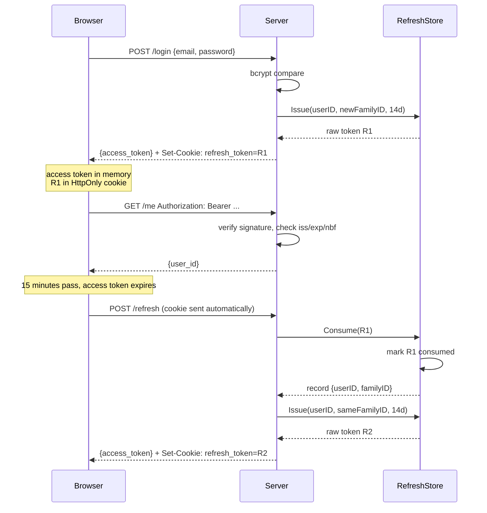
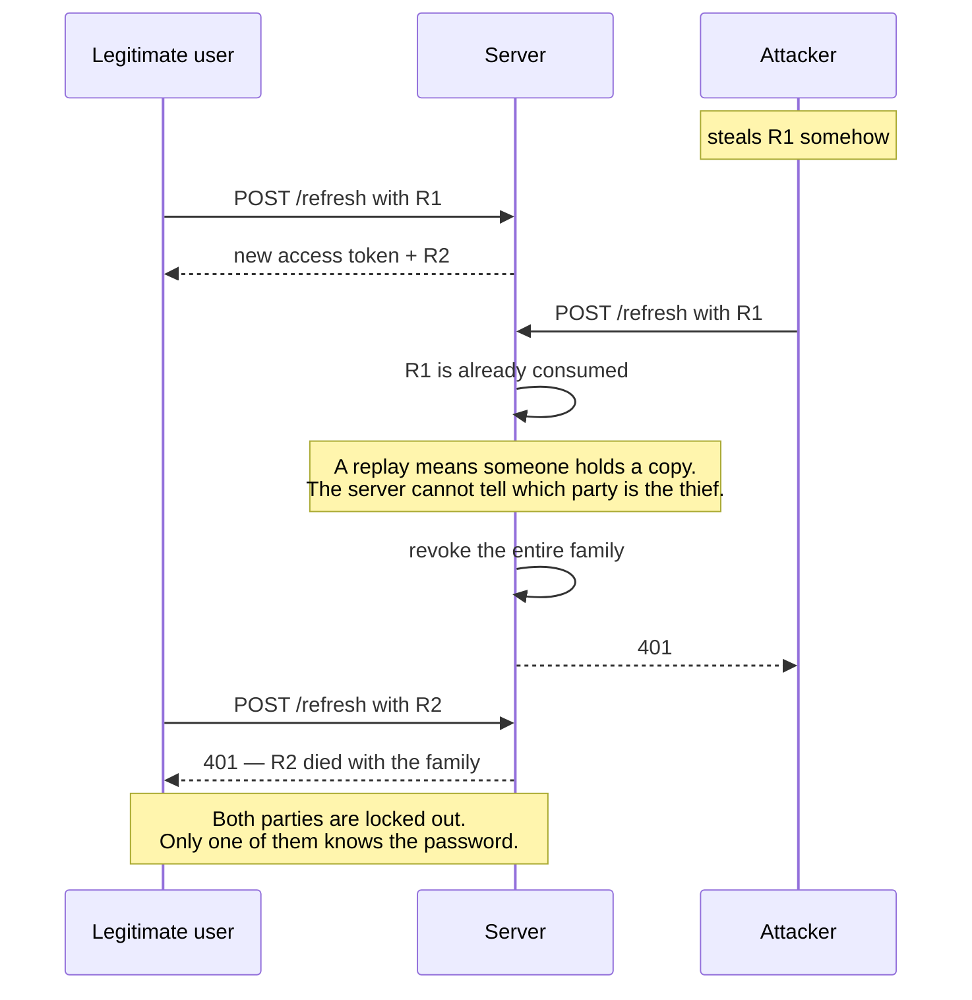

# jwtauth

JWT authentication written from scratch in Go — no JWT library, no auth framework. Signing, verification, claim validation, password hashing, rotating refresh tokens and reuse detection, all built on the standard library plus `golang.org/x/crypto` for bcrypt.

There's a small React frontend so the token lifecycle is something you can watch.

---
[](https://github.com/filipp-lotsmanov/jwtauth/actions/workflows/ci.yml)
[](https://goreportcard.com/report/github.com/filipp-lotsmanov/jwtauth)

## Why

I had known the concepts behind JWT authentication before, perhaps well enough to describe them in general terms 
but I still wanted to find out whether I actually understood them, 
so I have built the whole thing myself in Go instead of reaching for a library.

The parts I wanted to implement: what the signature actually covers, why the `alg` header can't be trusted, why a stateless token can't be revoked, and what you have to give up to get revocation back. Every non-obvious decision is written down below with the reasoning behind it.

It is a learning project. It runs on an in-memory store, seeds a single user from the environment, and has never seen production traffic. The parts that are missing are listed at the end.

---

## What's in it

| | |
|---|---|
| **HS256 signing and verification** | Built on `crypto/hmac` + `crypto/sha256`, verified byte-for-byte against a known test vector |
| **Algorithm allowlist** | `alg: none` and algorithm-confusion attacks rejected before any signature work happens |
| **Constant-time comparison** | `hmac.Equal`, so signature verification doesn't leak through response timing |
| **Issuer enforcement** | `iss` stamped by the signer and checked on every parse, so a token from another service with the same key is still rejected |
| **Clock skew leeway** | 60 seconds on `exp` and `nbf`, per RFC 7519 §4.1.4 |
| **Injected clock** | Expiry logic is deterministic and fully testable without waiting |
| **bcrypt password hashing** | With a configurable cost and the 72-byte limit handled explicitly |
| **Timing-equalised login** | An unknown email costs exactly as much as a wrong password, so the endpoint isn't a user-enumeration oracle |
| **Opaque refresh tokens** | 32 bytes of CSPRNG output, stored SHA-256 hashed, rotated on every use |
| **Reuse detection** | A replayed refresh token revokes every token descended from that login |
| **HttpOnly refresh cookie** | The long-lived credential is unreachable from JavaScript |
| **~90 tests** | Including a byte-exact signing vector, a 15-case rejection table, leeway boundary tests, and concurrency tests under `-race` |

---

## Architecture

```mermaid
flowchart TB
    subgraph browser["Browser"]
        react["React app<br/><i>access token in memory only</i>"]
        cookie[("refresh_token<br/>HttpOnly cookie")]
    end

    subgraph server["Go server :8080"]
        mux["http.ServeMux"]

        subgraph authpkg["internal/auth"]
            handler["Handler<br/>login · refresh · logout · me"]
            mw["RequireAuth<br/><i>middleware</i>"]
            users[("UserStore<br/>bcrypt hashes")]
            refresh[("RefreshStore<br/>SHA-256 hashes")]
        end

        subgraph tokenpkg["internal/token"]
            signer["Signer<br/>Sign · Parse · Validate"]
        end
    end

    react -->|"Bearer token"| mux
    cookie -.->|"sent automatically"| mux
    mux --> handler
    mux --> mw
    mw --> signer
    handler --> signer
    handler --> users
    handler --> refresh

    style tokenpkg fill:#1e3a5f,stroke:#2d5a8f
    style authpkg fill:#1e4620,stroke:#2d6a30
```



The layering is strict and one-directional: **`internal/token` never imports `net/http` and does not know what a user is.** It takes claims and produces a signed string; it takes a string and produces verified claims or an error. `internal/auth` owns users, passwords, sessions and HTTP. Go's compiler enforces the no-cycle half of that; the rest is discipline.

---

## The token lifecycle



### When a refresh token is stolen



That last diagram is the whole reason server-side refresh tokens exist. A purely stateless JWT system cannot detect that a credential was copied, and cannot take it back.

---

## Running it

**Requires:** Go 1.22+ (the method-prefixed `ServeMux` patterns need it), Node 20+ for the frontend.

```bash
git clone git@github.com:filipp-lotsmanov/jwtauth.git
cd jwtauth
```

### Configuration

Copy `.env.example` to `.env` and fill in the two blank values, or use a secrets manager — the server only reads environment variables, so either works.

```bash
go run ./cmd/genkey      # prints a 43-char base64url key for JWT_SECRET
```

| Variable | Example | Notes |
|---|---|---|
| `JWT_SECRET` | *(from genkey)* | 32 random bytes, base64url. Decoded to raw bytes at startup — the server rejects anything shorter than 256 bits. |
| `JWT_ISSUER` | `jwtauth-learning` | Stamped into every token as `iss` and enforced on verification. |
| `PORT` | `8080` | |
| `ACCESS_TOKEN_TTL` | `15m` | Any `time.ParseDuration` value. Use `30s` if you want to watch expiry happen in the demo. |
| `REFRESH_TOKEN_TTL` | `336h` | 14 days. Sliding — reset on every rotation. |
| `BCRYPT_COST` | `10` | ~100ms per hash. Tests use `bcrypt.MinCost`. |
| `COOKIE_SECURE` | `false` locally | Browsers reject `Secure` cookies over plain HTTP, so this must be `false` for `http://localhost` and `true` everywhere else. Defaults to `true` in `.env.example` so a missing value fails safe. |
| `SEED_USER_EMAIL` | `dev@example.com` | |
| `SEED_USER_PASSWORD` | *(yours)* | The store is in-memory, so this user is recreated on every boot. |

### Development

Two terminals. The Vite dev server proxies the API routes to Go, so the browser sees a single origin and the `SameSite=Strict` cookie behaves exactly as it will in production.

```bash
# terminal 1
go run ./cmd/server

# terminal 2
cd web && npm install && npm run dev
```

Open `http://localhost:5173`.

### Production-ish

```bash
cd web && npm run build && cd ..
go run ./cmd/server
```

Open `http://localhost:8080` — the Go binary serves the built frontend and the API from one origin.

---

## API

| Endpoint | Auth | Body | Returns |
|---|---|---|---|
| `POST /login` | — | `{"email", "password"}` | `{"access_token"}` + `Set-Cookie` |
| `POST /refresh` | refresh cookie | — | `{"access_token"}` + rotated `Set-Cookie` |
| `POST /logout` | refresh cookie | — | `204`, cookie cleared |
| `GET /me` | `Authorization: Bearer` | — | `{"user_id"}` |

`/login` and `/refresh` return `401 invalid credentials` on every failure, with an identical body regardless of cause. `/logout` returns `204` unconditionally so nobody can probe which tokens exist by watching status codes.

---

## Seeing family revocation for yourself

The frontend deliberately can't demonstrate this. The old refresh token lives in an HttpOnly cookie, so JavaScript can't read it to replay it — which is the security model working as designed. You need cookie jars:

```bash
# log in, saving the cookie
curl -c jar.txt -X POST localhost:8080/login \
  -H 'Content-Type: application/json' \
  -d '{"email":"dev@example.com","password":"your-seed-password"}'

# copy the jar — this is the "theft"
cp jar.txt stolen.txt

# the legitimate user refreshes; jar.txt now holds R2
curl -b jar.txt -c jar.txt -X POST localhost:8080/refresh

# the attacker replays R1
curl -b stolen.txt -X POST localhost:8080/refresh
# -> 401, and the server logs: refresh token reuse detected, family revoked

# the legitimate user's R2 is now dead too
curl -b jar.txt -X POST localhost:8080/refresh
# -> 401
```

On PowerShell, use `curl.exe` — plain `curl` is an alias for `Invoke-WebRequest`.

---

## Design decisions

Each of these was a real fork in the road. The alternative is given because the reasoning is more useful than the conclusion.

### Refresh tokens are opaque, not JWTs

**Alternative:** issue the refresh token as a second signed JWT with a longer expiry.

That would indeed be simpler — no storage, no lookup, verification is just a signature check. 
It also recreates exactly the problem refresh tokens exist to solve. A stateless token can't be revoked, so there'd be no way to end a session, no way to detect theft, and no way to log anyone out.

So refresh tokens are 32 bytes of `crypto/rand` output with a server-side record. The lookup *is* the verification.

### Stored hashed, with SHA-256 rather than bcrypt

A refresh token is a credential worth 14 days of access. A database dump shouldn't hand over live sessions, so only `sha256(token)` is stored — same reasoning as password hashing.

But **not** bcrypt. Bcrypt is deliberately slow to make brute-forcing low-entropy human passwords expensive. A 256-bit random token has nothing to brute-force, so the slowness buys nothing and costs 100ms on every refresh.

### Rotation, with family revocation on reuse

**Alternative considered and rejected:** reject the replayed token and leave everything else alone.

With rotation, each refresh token is single-use. A second presentation means one of two things, and the server cannot tell which:

- the legitimate client retried after a dropped response
- somebody has a copy

Rejecting only the replayed token handles exactly half of the theft cases. Walk it through: if the attacker refreshes first, the real user's next attempt is rejected and *they* re-authenticate — while the attacker keeps rotating their own valid token for two weeks. The victim has been logged out and left the thief alone.

So a replay revokes the whole family: every token descended from that login. Both parties lose access, and only one of them can get back in.

The cost is real: a flaky client that retries a refresh will log the user out. That's why refresh is treated as non-retryable on the client.

### Sliding expiry

Each rotation resets the 14 days rather than counting from the original login. An active user never has to log in again; an abandoned session dies two weeks after its last use.

The tradeoff is that a session can in principle live forever, so an attacker who keeps rotating a stolen token is never timed out. Production systems usually add an absolute family cap — sliding 14 days *plus* a hard 90-day ceiling. That's not implemented here.

### Login is timing-equalised

A natural `/login` returns 401 immediately when the email isn't found, and ~100ms later when the password is wrong. That difference is measurable over a network, which turns the endpoint into a user-enumeration oracle: one request per email address and you know who has an account.

So when the user doesn't exist, the handler runs a bcrypt comparison against a dummy hash generated at the same cost, discards the result, and returns the identical response. The dummy hash is generated in the constructor from the configured cost, so it can't drift out of sync.

The equalisation has to hold across *every* observable — status code, body text, and timing. During development this had a 404 on one path and a 401 on the other, which gave the whole thing away without any timing analysis at all.

### The verifier picks the algorithm

The `alg` field in a JWT header is attacker-controlled. Trusting it is how `alg: none` works, and how HS256/RS256 confusion works.

`Parse` checks `alg` against an allowlist of exactly one value before doing any signature work, and the check is positive (`!= "HS256"` → reject), not a denylist of known-bad values. A denylist only blocks the attacks I had thought of.

### Verification order is load-bearing

```
split → decode header → check alg → verify signature → decode claims → validate time
```

The claims are decoded **after** the signature check, not with the other base64 decodes where it would read more neatly. Anything unmarshalled before the signature gate is attacker-controlled data being turned into a struct my program can act on.

### The clock is injected

`Signer` holds a `now func() time.Time`, set to `time.Now` by the constructor and replaced in tests.

Without it, testing "this token expired one second ago" means arithmetic against the real wall clock, which produces tests that fail at awkward times in CI. With it, the leeway boundaries are testable to the exact second — including the cases that assert a token *is* still accepted, which are the only ones that catch an inverted comparison.

### 60 seconds of clock skew

RFC 7519 §4.1.4 permits it, and without it a token minted by a machine two seconds ahead of the verifier is rejected as not-yet-valid. That's an intermittent, unreproducible 401 that correlates with nothing in the logs.

The leeway widens the window at both ends — `exp` is extended, `nbf` is relaxed — which costs about 7% of a 15-minute token's lifetime. Worth it.

### Refresh token in an HttpOnly cookie

**Alternative:** return it in the JSON body and let the frontend hold it in `localStorage`.

That's simpler and needs no backend changes. It also means any XSS on the page reads the 14-day credential, and family revocation can't help — the attacker refreshes normally, rotating as they go, looking exactly like a legitimate client.

With `HttpOnly`, an XSS can still steal the access token, but it expires in minutes and can't be renewed. The long-lived credential is out of JavaScript's reach entirely. The frontend demonstrates this by printing `document.cookie`, which reads empty while the cookie is plainly visible in devtools.

`SameSite=Strict` is what replaces a CSRF token here, and it only works because the frontend is served from the same origin. A separate frontend port would need `SameSite=None`, which needs `Secure`, which needs TLS — and a CSRF token to replace the protection given up.

---

## What's deliberately missing

Named rather than quietly omitted:

- **A real database.** Both stores are in-memory maps behind an `RWMutex`. Restarting the server ends every session.
- **Expired-record cleanup.** `RefreshStore` grows until the process exits. A ticker-driven sweeper is the obvious fix.
- **Server timeouts.** `http.ListenAndServe` uses a zero-value `http.Server`, so there's no `ReadTimeout` or `WriteTimeout`. First thing to add before this faced a network.
- **Graceful shutdown.** No signal handling, no connection draining.
- **Rate limiting.** `/login` is timing-equalised but unthrottled.
- **An absolute session cap** on top of the sliding refresh expiry.
- **Asymmetric signing.** HS256 only. RS256/ES256 with a JWKS endpoint would matter if more than one service needed to verify these tokens; here, one service does both jobs.
- **Registration, password reset, email verification, MFA.** Out of scope — one seeded user is enough to exercise the token logic.

---

## Tests

```bash
go test ./...
go test ./... -race      # the concurrency tests only mean something with this
go vet ./...
```

A few worth knowing about:

**`TestSignMatchesVector`** compares all three segments against a fixed HS256 vector, cross-checked against two independent HMAC implementations. If the header segment matches but the signature doesn't, the signing input is wrong; if the header doesn't match, the JSON marshalling or base64 variant is wrong.

**`TestParseRejects`** is a 15-case table covering `alg: none`, a swapped `alg` on an otherwise-valid token, tampered payloads, signatures lifted from other tokens, wrong keys, and every malformed-structure case.

**`TestLeewayBoundaries`** asserts *acceptance* at the exact leeway edge. The rejection table passes even with an inverted comparison sign; these two tests are the only ones that don't.

**`TestRequireAuthRejects`** checks a flag on a spy handler, not just the status code. A missing `return` after `http.Error` writes a 401 *and* calls the protected handler — an auth bypass that a status assertion alone would never catch.

**`TestRefreshReuseRevokesFamilyOverHTTP`** rotates R1 → R2 → R3, replays R1, and asserts that R3 — never misused, held by the legitimate user — is now dead.

**`TestRefreshConcurrentConsumeAllowsOneWinner`** runs two goroutines against one token fifty times and requires exactly one success per round. Without the write lock spanning the check and the write, both can read `Consumed == false`.

---

## Layout

```
cmd/
  genkey/        prints a signing key
  server/        config, wiring, routes — no logic
internal/
  token/         JWTs. stdlib crypto only. knows nothing about users or HTTP
    token.go     Claims, Signer, Sign
    verify.go    Parse, Validate
    errors.go    sentinel errors
  auth/          users, passwords, sessions, HTTP
    password.go  bcrypt wrappers
    user.go      in-memory user store
    refresh.go   refresh token store, rotation, family revocation
    handler.go   login, refresh, logout, me
    middleware.go  bearer extraction, context propagation
web/             React + Vite frontend
```
